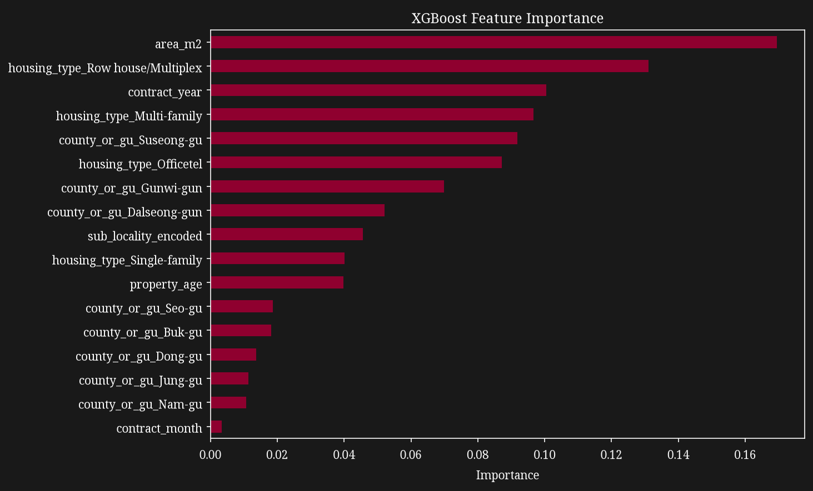
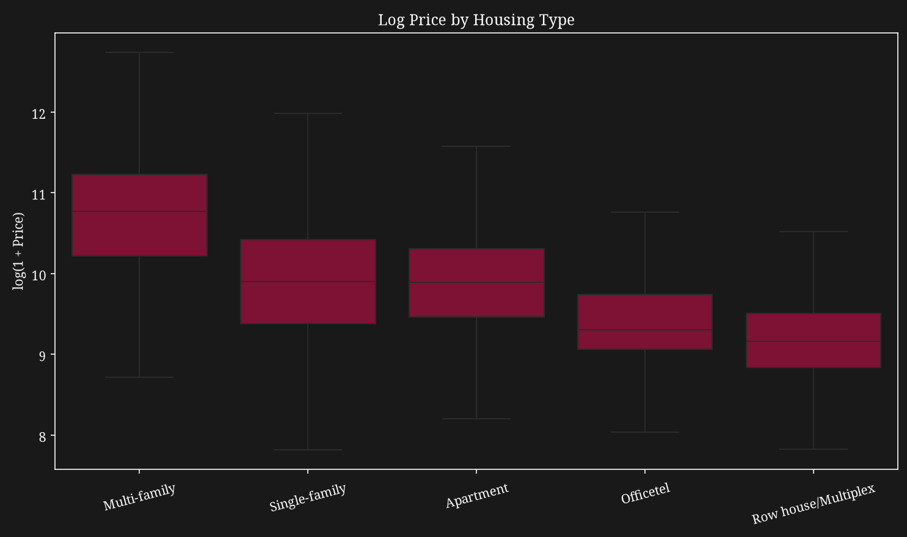
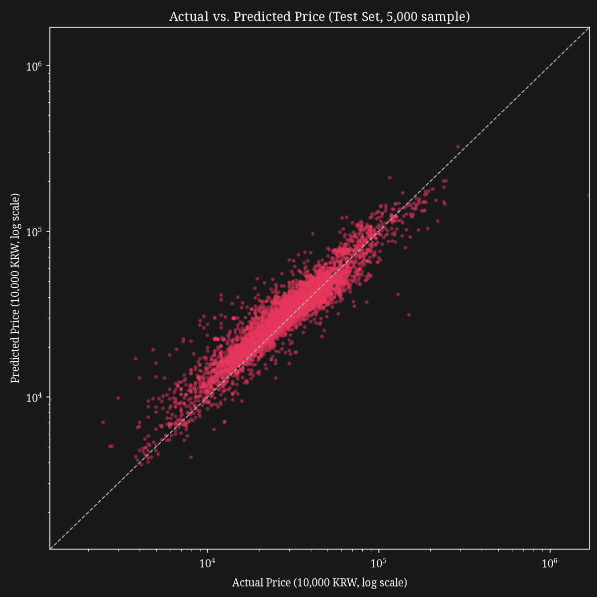

# Daegu Residential Property Price Prediction

A machine learning project predicting residential property transaction prices in Daegu, South Korea, using nearly 20 years of real government transaction records (2006-2024) across five housing types: Apartment, Single-family, Row house/Multiplex, Multi-family, and Officetel.

## Business Question

What does a residential property in Daegu sell for, given its location, size, age, and housing type, and which of these factors matter most in predicting that price?

## Model Performance

A tuned **XGBoost** regressor, selected over Random Forest (Wilcoxon signed-rank test across 10 time-series folds, p = 0.0059) and a linear baseline (training R² = 0.707, ruled out due to multicollinearity, non-linear relationships it could not capture, and an implausible sign on the Officetel effect caused by one shared size slope across all housing types).

The data was split by time, not at random: the model trained on 2006-2022 (686,512 transactions) and was evaluated on a held-out 2023-2024 test set (52,160 transactions never seen during training or tuning). All price errors below are in units of 10,000 KRW.

| Metric | Overall |
|---|---|
| RMSE | 12,084 |
| MAE | 5,881 (about 58.8 million KRW) |
| MAPE | 19.6% |

Performance by housing type (test set):

| Housing Type | Test Rows | RMSE | MAE | MAPE |
|---|---|---|---|---|
| Officetel | 1,003 | 3,587 | 2,050 | 13.8% |
| Apartment | 46,321 | 8,653 | 5,542 | 17.2% |
| Row house/Multiplex | 2,236 | 5,776 | 3,278 | 27.5% |
| Multi-family | 593 | 21,943 | 16,117 | 36.8% |
| Single-family | 2,007 | 43,370 | 15,499 | 62.8% |

## Key Findings

- **Property size and transaction year are the strongest, most consistent price drivers**, confirmed across multiple feature importance metrics, not just one. The median price rose about 3x over the period, from 10,300 in 2006 to 30,000 in 2024.
- **Accuracy varies sharply by housing type**: Officetel is predicted most reliably (13.8% MAPE), likely due to its standardized unit sizes, while Single-family is the weakest (62.8% MAPE), driven by two distinct causes: a scarcity of large, high-value training examples, and small central-district properties whose redevelopment value is not captured by district-level location alone.
- **Small properties in central districts carry a price premium per square meter**, the opposite of what a simple linear size-to-price relationship would predict. This non-linearity is a large part of why a tree-based model outperforms a linear one.
- **Housing type changes the meaning of size**: Officetels are much smaller on average than Apartments (44.1 vs 79.8 m²) and, among matched 30-60 m² units, sell for more per square meter (291.5 vs 241.7), so a single shared area slope misleads a linear model.
- **Feature importance rankings depend on the metric used**: categorical features (housing type) score highly on `gain` (large, decisive splits), while continuous features (location encoding) score highly on `weight` and `cover` (frequent, incremental use). Both are real contributions, measured differently.

## Recommendations

1. The model is most reliable for Apartment transactions (74% of the training data), and can reasonably support automated or semi-automated price estimation for this segment.
2. For Single-family and Multi-family properties, especially small properties in central districts or unusually large ones, treat predictions as a rough reference only, not a substitute for manual appraisal.
3. Future iterations would benefit most from precise property coordinates, to replace the current district-level location granularity, and a disambiguated building-vs-unit area field for Single-family/Multi-family transactions.
4. Given how differently housing types behave, a future version could test housing-type-specific models rather than one shared model.

## Visuals





## Data

This project uses Daegu residential property transaction records (August 2005 to December 2024, 740,480 raw transactions), sourced from Korea's Ministry of Land, Infrastructure and Transport, Actual Transaction Price Disclosure System, via the Public Data Portal. After cleaning, 738,672 transactions remain; the 21 rows from 2005 were dropped because a single partial year cannot support time-based modelling, so the analysis covers 2006-2024.

Address-level identifiers (lot numbers, road name, building name) were excluded, as they do not generalize to properties the model has not seen. Columns with structural missingness tied to specific housing types or a 2021 disclosure policy change (`land_area_m2`, `land_ownership_area_m2`, `transaction_type`) were also excluded rather than imputed. The two area columns were merged into a single `area_m2` feature. Full column definitions are in [`data/data_dictionary.md`](data/data_dictionary.md).

**License:** [KOGL Type 1](https://www.kogl.or.kr/info/license.do), free to use, redistribute, and adapt, with attribution required. Independently compiled, not affiliated with or endorsed by the Ministry of Land, Infrastructure and Transport.

**Getting the full data:** the raw file (99.5 MB) is not tracked in this repository. It sits just under GitHub's 100 MB file limit and is excluded through `.gitignore` to keep the repository light. Download it from [Kaggle: daegu apartment actual transaction](https://www.kaggle.com/datasets/lnoahl/daegu-aptmernt-actual-transaction) and place it at `data/raw/Daegu_apt.csv` before running the notebook.

## Limitations

This analysis covers nearly 20 years of transactions, but location is known only at the district and sub-locality level. No coordinates are available, which limits the model's ability to price individual parcels precisely and is the primary driver of the Single-family segment's weaker performance. Prices are used as recorded and are not adjusted for inflation or macroeconomic conditions across the period, so the model reflects nominal price patterns, not real, policy-adjusted ones. Transaction volume also dipped sharply in 2021-2022, which the model sees only as a pattern in the data, not as a policy or interest rate effect. Recorded building ages show heaping at round numbers, so age is an approximate signal. Whether unusually large Single-family/Multi-family transactions represent legitimate whole-building sales or a recording inconsistency could not be resolved with the columns available.

## Tools

Python, pandas, numpy, scikit-learn, xgboost, statsmodels, scipy, matplotlib, seaborn, joblib, Jupyter Notebook

## How to Run

1. Clone the repository:
   `git clone https://github.com/ditodjati/Daegu-Apartment-Price-Prediction.git`
2. Obtain the raw dataset and place it at `data/raw/Daegu_apt.csv` (see **Data** above)
3. Create and activate a virtual environment:
   `python -m venv venv` then `venv\Scripts\activate` (Windows)
4. Install dependencies: `pip install -r requirements.txt`
5. Open `notebooks/Daegu_Apartment_Price_Prediction.ipynb` in Jupyter or VS Code, and select the `venv` kernel
6. Run all cells

Notes: the notebook uses relative paths (`../data`, `../models`), so run it from inside the `notebooks/` folder. The hyperparameter search is the slowest step and can take a while on a laptop. Plots use the Noto Serif font and fall back to a default font if it is not installed.

## Using the Saved Model

The trained model and its preprocessing details are saved in `models/`. The model predicts the **log of the price**, so predictions must be converted back with `np.expm1`.

```python
import joblib
import numpy as np

model = joblib.load("models/final_model.pkl")
artifacts = joblib.load("models/preprocessing_artifacts.pkl")

# X_new must already contain the engineered columns: contract_year,
# contract_month, area_m2, property_age, the one-hot county_or_gu and
# housing_type columns, and sub_locality_encoded (built from
# artifacts["sub_locality_encoding"], using
# artifacts["global_mean_log_price"] for unseen sub-localities).
X_new = X_new[artifacts["feature_cols"]]

predicted_price = np.expm1(model.predict(X_new))  # in units of 10,000 KRW
```

Pickle files depend on library versions, so use the versions in `requirements.txt` when loading. Only load pickle files from sources you trust.

## Repository Structure

```
Daegu-Apartment-Price-Prediction/
├── data/
│ ├── raw/
│ |   └── Daegu_apt.csv      (not tracked, see Data section)
│ ├── processed/             (generated by running the notebook)
│ └── data_dictionary.md
├── models/
│ ├── final_model.pkl
│ └── preprocessing_artifacts.pkl
├── notebooks/
│ └── Daegu_Apartment_Price_Prediction.ipynb
├── reports/
│ └── figures/
│   ├── actual_vs_predicted.png
│   ├── correlation_heatmap.png
│   ├── feature_importance.png
│   ├── price_by_district.png
│   ├── price_by_housing_type.png
│   ├── price_distribution.png
│   └── price_trend_over_time.png
├── .gitignore
├── README.md
└── requirements.txt
```

## Full Analysis

See the full notebook for detailed methodology, data cleaning steps, and findings for each section: notebooks/Daegu_Apartment_Price_Prediction.ipynb